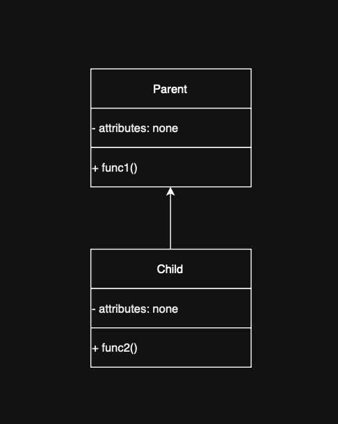
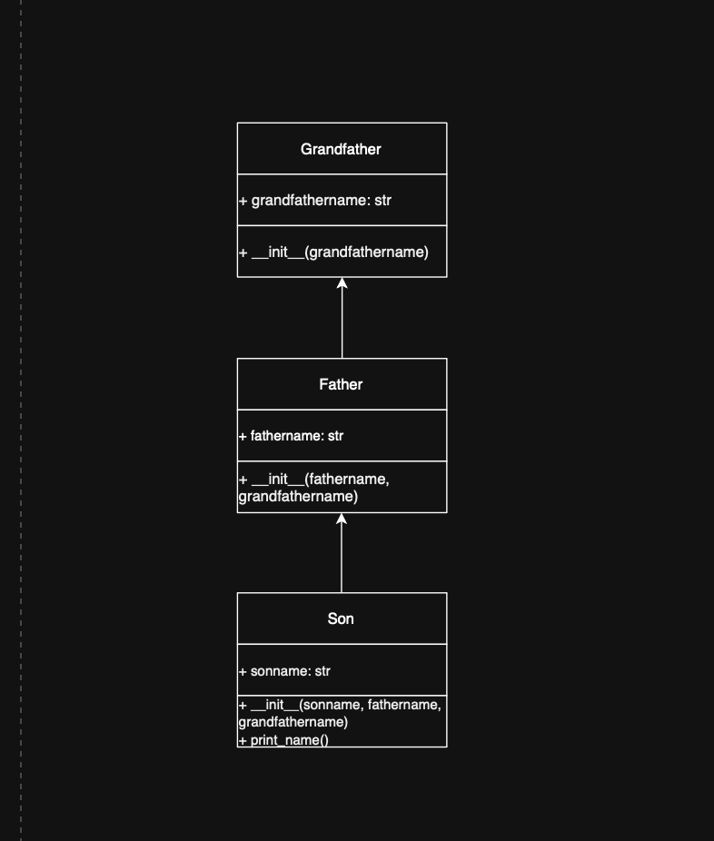
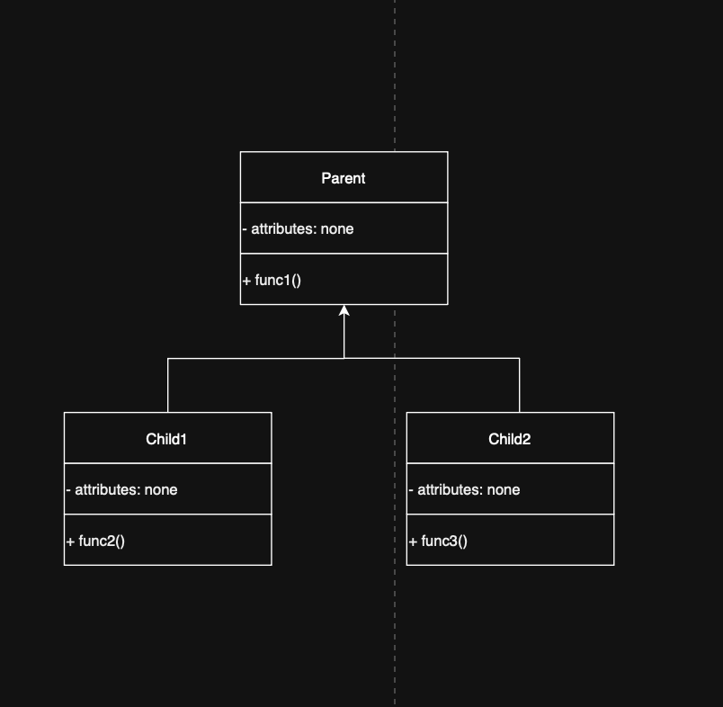

# Activity 2: Deepening Understanding of Inheritance

**Allotted Time:** 20 minutes  
**Grading:** Non-graded (Submission not required)  

---

**1. For each code example on single, multilevel, and hierarchical inheritance, create the
corresponding class diagram in your notebook. Clearly identify the attributes and methods of
each class. Show the correct inheritance relationship between classes.**

1. Single Inheritance Diagram


2. Multilevel Inheritance Diagram


3. Hierarchical Inheritance Diagram


---

**2. Run the code examples in your IDE. Modify the code by adding getter and setter methods,
changing object values, adding new objects, and adjusting method outputs. Observe how
these changes affect the program. Experiment freely to strengthen your understanding of
inheritance.**

1. Single Inheritance (single_inheritance.py)

```python
class Parent:

  def __init__(self, msg):
    self._msg = msg

  @property
  def msg(self):
    return self._msg

  @msg.setter
  def msg(self, val):
    self._msg = val

  def func1(self):
    print(self._msg)


class Child(Parent):

  def __init__(self, msg, c_msg):
    super().__init__(msg)
    self._c_msg = c_msg

  @property
  def c_msg(self):
    return self._c_msg

  @c_msg.setter
  def c_msg(self, val):
    self._c_msg = val

  def func2(self):
    print(self._c_msg)


obj = Child("Parent msg", "Child msg")
obj.func1()
obj.func2()

obj.msg = "Updated parent"
obj.c_msg = "Updated child"
obj.func1()
obj.func2()

obj2 = Child("New parent", "New child")
obj2.func1()
obj2.func2()
```python

### 2. MultiLevel Inheritance (multilevel_inheritance.py)

class Grandfather:

  def __init__(self, g_name):
    self._g_name = g_name

  @property
  def g_name(self):
    return self._g_name

  @g_name.setter
  def g_name(self, val):
    self._g_name = val


class Father(Grandfather):

  def __init__(self, f_name, g_name):
    super().__init__(g_name)
    self._f_name = f_name

  @property
  def f_name(self):
    return self._f_name

  @f_name.setter
  def f_name(self, val):
    self._f_name = val


class Son(Father):

  def __init__(self, s_name, f_name, g_name):
    super().__init__(f_name, g_name)
    self._s_name = s_name

  @property
  def s_name(self):
    return self._s_name

  @s_name.setter
  def s_name(self, val):
    self._s_name = val

  def print_name(self):
    print(self._g_name, self._f_name, self._s_name)


s1 = Son("Prince", "Rampal", "Lal mani")
s1.print_name()

s1.g_name = "Lal Bahadur"
s1.f_name = "Vikram"
s1.s_name = "Aryan"
s1.print_name()

s2 = Son("Leo", "Arthur", "Edward")
s2.print_name()

### 3.Hierarchical Inheritance (hierarchical_inheritance.py)

class Parent:

  def __init__(self, text):
    self._text = text

  @property
  def text(self):
    return self._text

  @text.setter
  def text(self, val):
    self._text = val

  def func1(self):
    print(self._text)


class Child1(Parent):

  def func2(self):
    print("Child 1")


class Child2(Parent):

  def func3(self):
    print("Child 2")


class Child3(Parent):

  def func4(self):
    print("Child 3")


o1 = Child1("Text 1")
o2 = Child2("Text 2")
o3 = Child3("Text 3")

o1.func1()
o1.func2()

o2.text = "Updated text 2"
o2.func1()
o2.func3()

o3.func1()
o3.func4()
